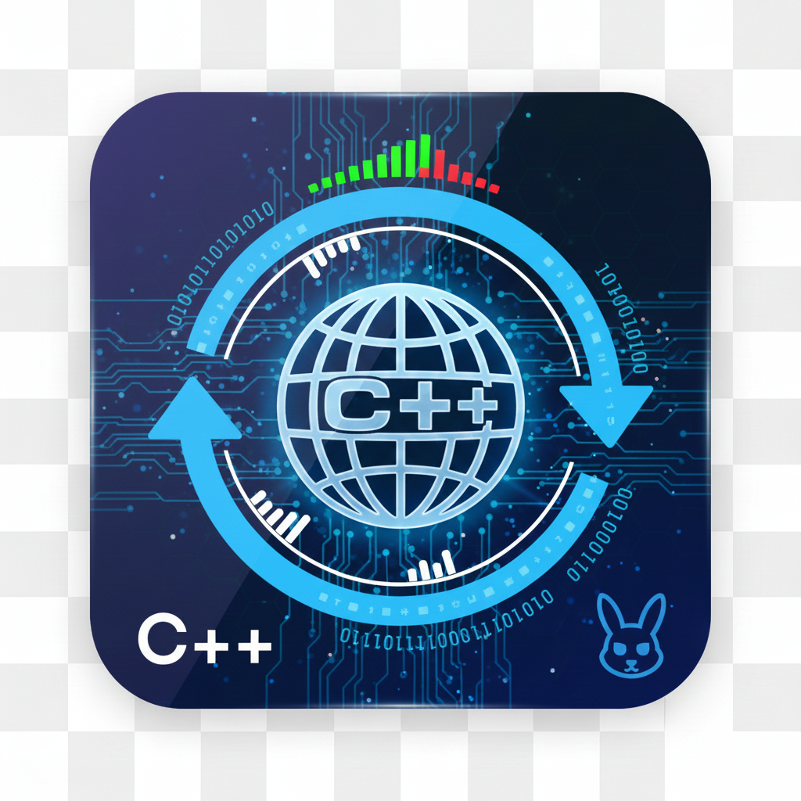
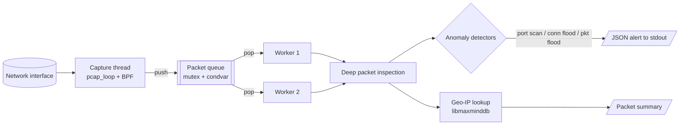

<div align="center">



# 🛡️ ExtremeSniffer — C++ Network Security Tool

### Multithreaded libpcap packet inspector with anomaly detection, JSON alerts and Geo-IP enrichment

  

[](LICENSE)    

[](https://codespaces.new/shiroonigami23-ui/CPP-Network-Security-Tool?quickstart=1) [](https://github.com/shiroonigami23-ui/CPP-Network-Security-Tool/archive/refs/heads/main.zip)

[**Overview**](#-overview) · [**Features**](#-features) · [**Architecture**](#-architecture) · [**Getting Started**](#-getting-started) · [**Roadmap**](#-roadmap)

</div>

---

## 📖 Overview

**ExtremeSniffer** is a C++ network-security tool that captures live traffic with **libpcap**, performs
**deep packet inspection** (IPs, ports, protocols, HTTP methods, User-Agents), and runs **real-time anomaly heuristics**
that flag port scans, connection floods and packet floods as structured **JSON alerts**. Packet summaries are enriched with
**Geo-IP** city/country data via MaxMind's `libmaxminddb`.

Capture and analysis are decoupled with a **producer–consumer** design: one capture thread feeds a mutex/condition-variable
protected queue that multiple processing threads drain concurrently. The repo also ships a security analysis
(`CybersecurityAnalysis.md`) and a LaTeX white-paper (`paper.tex`).

### ✨ Highlights

- **Producer–consumer multithreading** with `pthread` mutexes and condition variables
- **Three detectors**: port scan (≥5 ports), connection flood (≥15 IP:port pairs), packet flood (≥50 packets) per source
- **BPF filters** for precise capture (e.g. `tcp`, `udp port 53`)
- **Geo-IP enrichment** of packet summaries with thread-safe MMDB lookups

## 🧩 Features

| Feature | What it does |
|---|---|
| **Deep packet inspection** | Parses Ethernet/IP/TCP/UDP headers and HTTP payloads (method, Host, User-Agent) |
| **Port-scan detection** | Tracks distinct destination ports per source IP; alerts at `PORT_SCAN_THRESHOLD` |
| **Connection-flood detection** | Counts distinct IP:port connections per source; alerts at `CONNECTION_FLOOD_THRESHOLD` |
| **Packet-flood detection** | Per-source flow counters; alerts at `PACKET_FLOOD_THRESHOLD` |
| **JSON alerting** | Machine-readable alerts (`anomaly_type`, IPs, detected value, threshold) ready for a SIEM / log pipeline |
| **Geo-IP lookup** | City + country for source and destination via `GeoLite2-City.mmdb` |
| **Basic sniffer** | `NetworkSniffer.cpp` — the original single-threaded version, kept for comparison |
| **Research write-up** | `paper.tex` / `main.tex` white-paper + `CybersecurityAnalysis.md` threat model |

## 📄 Technical Whitepaper

**[Read the whitepaper (PDF)](docs/WHITEPAPER.pdf)** · [Markdown version](docs/WHITEPAPER.md)

Architecture, detection model (port scan / connection flood / packet flood), Geo-IP enrichment, an honest limitations table and the evaluation plan.

## 🛠 Tech Stack

| Layer | Technology |
|---|---|
| Language | C++ (g++), POSIX threads |
| Capture | libpcap + Berkeley Packet Filter |
| Enrichment | libmaxminddb + MaxMind GeoLite2-City |
| Docs | LaTeX (white-paper), Markdown analysis, SVG protocol diagrams |
| Platform | Linux (raw-socket privileges required) |

## 🏗 Architecture

A single capture thread produces raw packets; N worker threads consume, inspect, detect and alert.



➡️ Full design notes, data flow and design decisions: **[docs/ARCHITECTURE.md](docs/ARCHITECTURE.md)**

## 📁 Project Structure

```text
CPP-Network-Security-Tool/
├── ExtremeSniffer.cpp        # multithreaded DPI + anomaly detection + Geo-IP
├── NetworkSniffer.cpp        # original basic sniffer
├── CybersecurityAnalysis.md  # threat model, limitations, enhancements
├── paper.tex / main.tex      # LaTeX white-paper (+ references.bib)
├── Papers/                   # paper sources
└── visual/                   # banner + protocol diagrams (SVG)
```

## 🚀 Getting Started

### Prerequisites

- Linux with `g++`
- `sudo apt-get install libpcap-dev libmaxminddb-dev`
- MaxMind `GeoLite2-City.mmdb` (free account at maxmind.com) — update `MMDB_DATABASE_PATH` in `ExtremeSniffer.cpp`

### 1. Get the code

Pick whichever method suits you:

| Method | Command |
|---|---|
| **HTTPS** | `git clone https://github.com/shiroonigami23-ui/CPP-Network-Security-Tool.git` |
| **SSH** | `git clone git@github.com:shiroonigami23-ui/CPP-Network-Security-Tool.git` |
| **GitHub CLI** | `gh repo clone shiroonigami23-ui/CPP-Network-Security-Tool` |
| **ZIP** | [Download](https://github.com/shiroonigami23-ui/CPP-Network-Security-Tool/archive/refs/heads/main.zip) and extract |
| **Codespaces** | [Open in browser](https://codespaces.new/shiroonigami23-ui/CPP-Network-Security-Tool?quickstart=1) — zero local setup, dev container preconfigured |

> 🔑 **Using SSH for the first time?** Generate a key with `ssh-keygen -t ed25519 -C "you@example.com"`, add the `.pub` contents at **GitHub → Settings → SSH and GPG keys**, then test with `ssh -T git@github.com`.

### 2. Install & set up

```bash
cd CPP-Network-Security-Tool
g++ ExtremeSniffer.cpp -o ExtremeSniffer -lpcap -pthread -lmaxminddb
```

### 3. Run

```bash
sudo ./ExtremeSniffer          # raw-socket capture needs root (or CAP_NET_RAW)
```
Tune detection in the `#define` block at the top of `ExtremeSniffer.cpp`:
`PORT_SCAN_THRESHOLD`, `CONNECTION_FLOOD_THRESHOLD`, `PACKET_FLOOD_THRESHOLD`, `NUM_PROCESSING_THREADS`, `PACKET_CAPTURE_LIMIT`.

### 🐳 Docker (optional)

```bash
docker build -t extremesniffer .
docker run --rm --net=host --cap-add=NET_RAW --cap-add=NET_ADMIN \
  -v $PWD/GeoLite2-City.mmdb:/app/GeoLite2-City.mmdb extremesniffer
```

## 🎮 Usage

Example alert emitted to stdout (Geo-IP details are printed alongside packet summaries):

```json
{
  "anomaly_type": "Port Scan",
  "source_ip": "192.168.1.23",
  "destination_ip": "N/A",
  "detected_value": 7,
  "threshold": 5
}
```

⚠️ Only capture traffic on networks you own or are authorised to monitor.

## 🗺 Roadmap

**v1.0 — Prototype (done)**

- [x] libpcap capture with BPF filtering
- [x] Producer–consumer multithreading
- [x] Port-scan, connection-flood and packet-flood heuristics with JSON alerts
- [x] Geo-IP enrichment
- [x] Security analysis and LaTeX white-paper

**v1.1 — Production hardening**

- [ ] CLI flags for interface, BPF filter, thresholds, thread count and MMDB path (no recompiling)
- [ ] Sliding time windows so counters decay instead of growing forever
- [ ] Lock-free ring buffer to replace the mutex-protected `std::queue`
- [ ] CMake build + GitHub Actions CI with unit tests on pcap fixtures

**v2.0 — Smarter detection**

- [ ] SYN-flood, DNS-tunnelling and ARP-spoofing detectors
- [ ] Statistical / ML anomaly scoring (EWMA baselines, isolation forest)
- [ ] Output sinks — syslog, Elasticsearch, Kafka
- [ ] Live terminal dashboard (ncurses) with top talkers and alert feed

➡️ Detailed plan, milestones and long-term vision: **[docs/ROADMAP.md](docs/ROADMAP.md)**

## 🤝 Contributing

Contributions, issues and feature requests are welcome!

1. Fork the repository
2. Create a feature branch: `git checkout -b feature/amazing-feature`
3. Commit your changes: `git commit -m "feat: add amazing feature"`
4. Push the branch: `git push origin feature/amazing-feature`
5. Open a Pull Request against `main`

Check the [issues page](https://github.com/shiroonigami23-ui/CPP-Network-Security-Tool/issues) and the [roadmap](docs/ROADMAP.md) for ideas on where to help.

## 📜 Changelog

See [CHANGELOG.md](CHANGELOG.md) for the release history.

## 📄 License

Distributed under the **MIT** license. See [LICENSE](LICENSE) for details.

## 👤 Author

**Aryan Singh Chandel** (Shiro)

[](https://github.com/shiroonigami23-ui)

<div align="center">

⭐ **If you find this project useful, consider giving it a star!** ⭐

</div>
