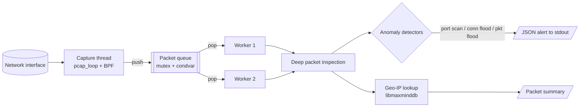

# 🏗 Architecture — ExtremeSniffer — C++ Network Security Tool

> Part of [CPP-Network-Security-Tool](https://github.com/shiroonigami23-ui/CPP-Network-Security-Tool). Back to the [README](../README.md).

## 1. System Overview

The program is a classic producer–consumer pipeline. The capture thread runs `pcap_loop` and copies each raw packet
into a shared queue. Worker threads block on a condition variable, pop packets, parse headers, update per-source
counters in shared maps and evaluate the three threshold detectors. Geo-IP lookups (serialised by a dedicated MMDB mutex)
enrich the packet summaries, and any detector that crosses its threshold prints a JSON alert.

## 2. Components

| Component | Location | Responsibility |
|---|---|---|
| **Capture thread** | `ExtremeSniffer.cpp → capture_thread_func` | Opens the device, applies BPF filter, pushes packets |
| **Packet queue** | `ExtremeSniffer.cpp → queue_mutex / queue_cond` | Thread-safe hand-off between capture and workers |
| **Workers** | `ExtremeSniffer.cpp` | Header parsing, HTTP payload inspection, detector updates |
| **Detectors** | `ExtremeSniffer.cpp` | port_scan_monitor, connection_flood_monitor, flow_monitor |
| **Geo-IP** | `ExtremeSniffer.cpp → mmdb_mutex` | MaxMind lookups for alert enrichment |
| **Alerting** | `ExtremeSniffer.cpp → generate_json_alert` | Formats detector hits as JSON |
| **Baseline sniffer** | `NetworkSniffer.cpp` | Single-threaded reference implementation |

## 3. Data / Control Flow

1. `main` initialises libpcap, MMDB and spawns `NUM_PROCESSING_THREADS` workers.
2. The capture thread receives packets matching the BPF filter and enqueues them, signalling one waiting worker.
3. A worker dequeues a packet, parses L2–L4 headers and, for HTTP, the request line and headers.
4. Per-source counters are updated and Geo-IP data is looked up for the packet summary; if any threshold is reached a JSON alert is printed.
5. After `PACKET_CAPTURE_LIMIT` packets the capture thread sets `terminate_processing` and broadcasts; workers drain and exit.

## 4. Key Design Decisions

| Decision | Rationale |
|---|---|
| Producer–consumer threads | Capture never blocks on slow analysis, reducing dropped packets |
| Dedicated MMDB mutex | libmaxminddb lookups are not guaranteed thread-safe across shared handles |
| JSON output | Easy to pipe into jq, log shippers or a SIEM |
| Compile-time thresholds | Simple for a prototype; CLI configuration is on the roadmap |

## 5. Known Limitations

- `MMDB_DATABASE_PATH` is hard-coded (Colab/Drive path) and must be edited before building
- Counters never expire, so long captures will eventually alert on normal traffic
- Capture limited to 100 packets by default (`PACKET_CAPTURE_LIMIT`)

---
*Last updated: 2026-11-14*
