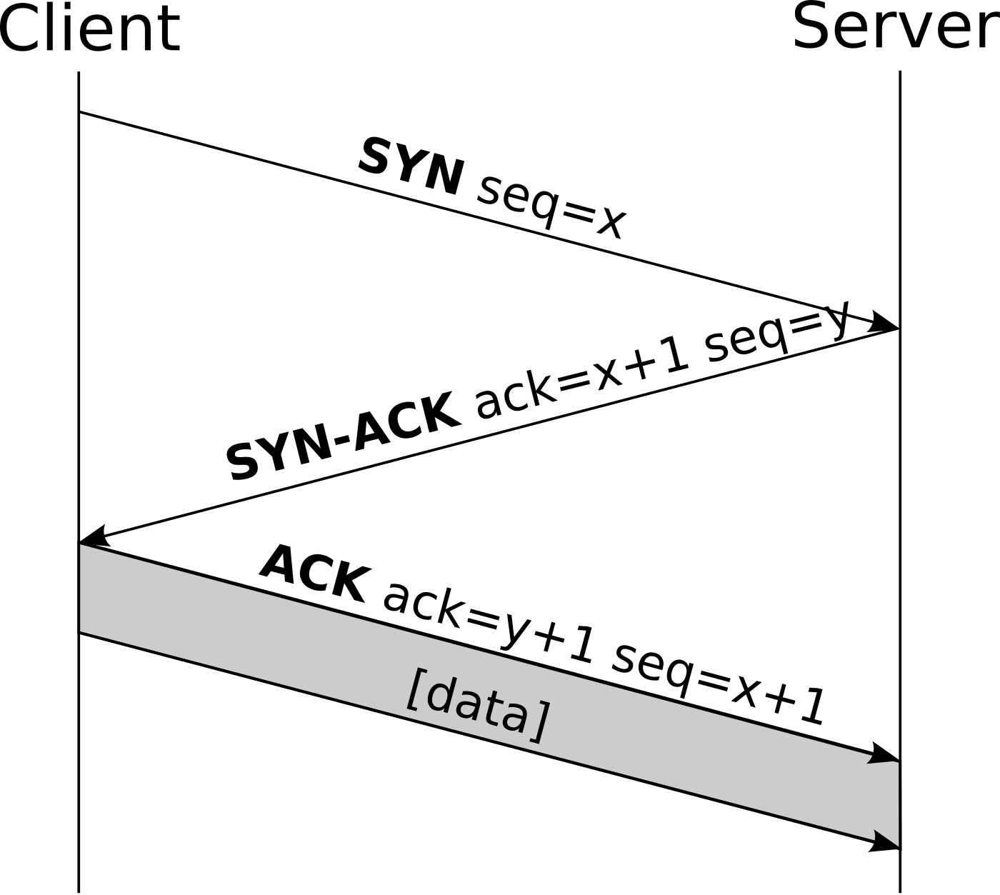
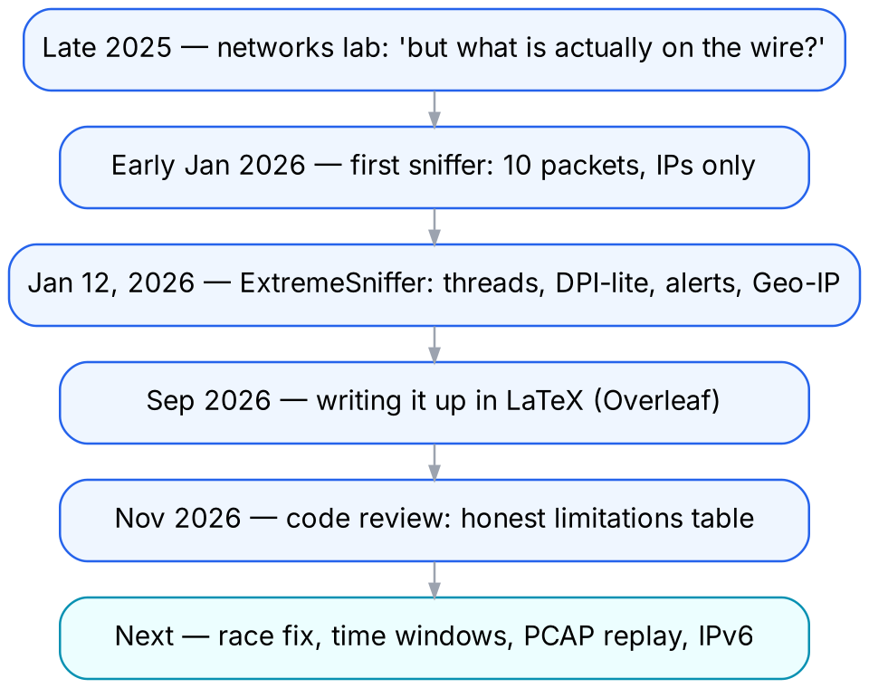
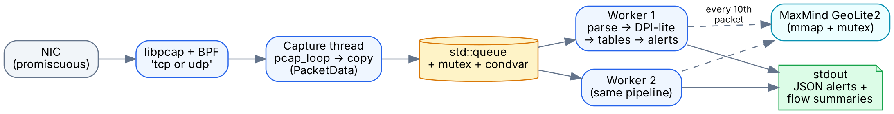
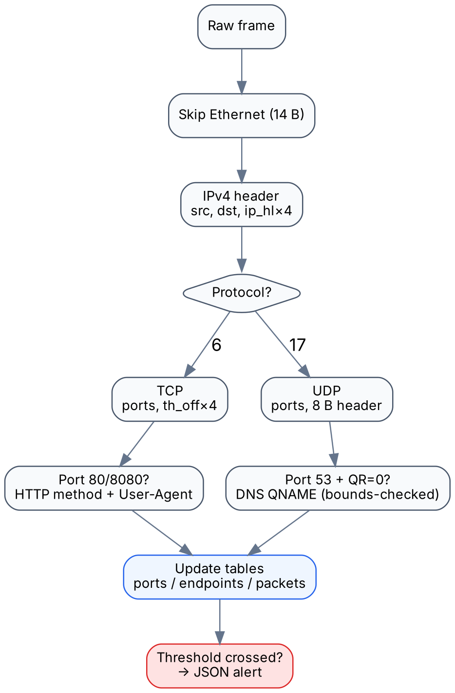
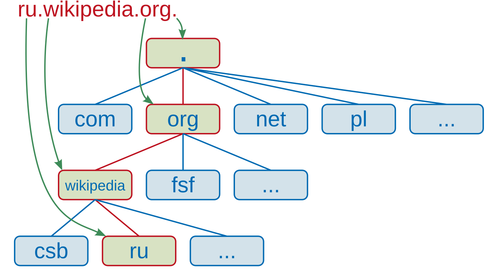

# "But What Is Actually on the Wire?"

## A question from a networks class

Every CS student meets the OSI model and the TCP/IP stack. You draw the layers, memorise the three-way handshake, label the header fields, write it in the exam, and move on. That's exactly what I did for a while.

But in my computer networks coursework there was one moment where something didn't sit right with me. We were going through the TCP handshake diagram (SYN, SYN-ACK, ACK) for maybe the tenth time, and I realised I had **never actually seen one.** Not in a diagram. A real one, on a real network, coming out of my own machine.

{width=58%}

That bugged me more than it should have. I'd been coding for years, building web apps that make thousands of network requests, and the network itself was still a black box. Requests went in, responses came out, and everything in between was a diagram in a textbook.

So the question that started this project was really simple:

> **What is actually on the wire right now?**

## From curiosity to security

Once I started reading about packet capture, the security angle showed up immediately. The same tools that let you *see* traffic are how network defenders spot attacks:

- A machine touching dozens of ports on another machine in seconds? That's a **port scan**: someone mapping what's open.
- One source opening connections to many different endpoints? Possibly a **connection flood**, or scanning across many hosts.
- One source blasting packets nonstop? Possibly a **packet flood**, a crude denial-of-service.

Big intrusion detection systems like Snort, Suricata and Zeek do this professionally. But they're huge, with complex configuration, rule languages and their own ecosystems. I didn't want to *use* an IDS. I wanted to **understand how one works**, and the best way I know to understand something is to build a small version of it from scratch.

## The goal

The goal I wrote down was:

> Build a small, readable C++ program that captures live traffic, understands enough of it to be useful (who's talking to whom, over what, from where), and raises a clear, structured alert when a host behaves like a scanner or a flooder.

Three words in there mattered most to me: **small**, **readable** and **structured**. Small, because I wanted to understand every line. Readable, because I wanted it to double as a learning resource. Structured, because alerts printed as random text are useless to any other tool. JSON alerts can be piped anywhere.

This document is the journey: from a 50-line "print 10 packets" experiment to a multithreaded sniffer with protocol inspection, anomaly detection and Geo-IP, plus the late nights, the strange decision to develop a packet sniffer *inside Google Colab*, and an honest code review I did on my own work ten months later.

{width=62%}


# Where I Was When I Started

## Skills going in

At the turn of 2026 I was in my third year of B.Tech CSE at RJIT. For this project specifically:

| Area | Level |
|---|---|
| C++ | Strong for DSA and coursework; STL containers were second nature |
| C-style systems programming (raw pointers, structs over bytes) | Okay, but rusty |
| POSIX threads, mutexes, condition variables | Textbook knowledge, very little real use |
| Networking theory | Fresh from coursework |
| libpcap | Zero. Never used it |
| Packet formats at the byte level | I knew the diagrams, not the offsets |

The gap between "I know the TCP header has a data offset field" and "I know that field is in the top 4 bits of byte 12 and counts 32-bit words" turned out to be the whole project.

## The environment problem

Here's a struggle that shaped the code in a way you can still see today.

Packet capture needs two things:

1. **libpcap** (the capture library) and its headers.
2. **Raw-socket privileges**, meaning root, or the `CAP_NET_RAW` capability on Linux.

My daily machine wasn't a convenient Linux box with root, and setting up libpcap development headers on Windows is its own adventure. I didn't want the project to stall on setup.

So I did something slightly unusual: **I developed it in Google Colab.**

Colab gives you a Linux virtual machine where you're root, `apt-get install libpcap-dev libmaxminddb-dev` just works, and there's a real network interface with real traffic (the notebook talking to Google's servers). I wrote the C++ in cells, compiled with `!g++`, ran the binary and watched the packets scroll by. For the Geo-IP database I uploaded the MaxMind file to my Google Drive and mounted it into the notebook.

If you look at the code today, that decision is frozen in one line:

```cpp
#define MMDB_DATABASE_PATH "/content/drive/My Drive/CPPNetworkSecurity/GeoLite2-City.mmdb"
```

That's a Colab Drive path, hard-coded. It made total sense in the notebook and makes zero sense anywhere else. It's on the fix list, and it's also a little time capsule of how the project was actually built.

## What I wanted to learn

- **libpcap end to end:** opening an interface, compiling a BPF filter, receiving packets.
- **Parsing raw bytes into headers:** Ethernet → IP → TCP/UDP → application data.
- **Real concurrency in C++** with pthreads, not just theory.
- **How detection actually works**, at the simplest level that's still meaningful.
- **Shipping a C++ tool** others can run, via Docker, since nobody wants my Colab notebook.


# Version Zero: Ten Packets

## The first sniffer

The first program was tiny. `NetworkSniffer.cpp` is still in the repo, and I kept it on purpose, because it's the "hello world" that everything grew from. It does four things:

1. Find network interfaces with `pcap_findalldevs`.
2. Open the first one in promiscuous mode with `pcap_open_live`.
3. Capture exactly 10 packets with `pcap_loop`.
4. Print the length, source IP and destination IP of each.

The core is the callback that libpcap calls for every packet:

```cpp
void packet_handler(u_char *args, const struct pcap_pkthdr *header, const u_char *packet) {
    struct ip *ip_header = (struct ip *)(packet + 14);   // skip Ethernet header
    std::cout << "Length: " << header->len << " bytes" << std::endl;
    std::cout << "Source IP: " << inet_ntoa(ip_header->ip_src) << std::endl;
    std::cout << "Dest IP:   " << inet_ntoa(ip_header->ip_dst) << std::endl;
}
```

That `packet + 14` line is where the textbook became real for me. An Ethernet frame starts with 6 bytes of destination MAC, 6 bytes of source MAC and 2 bytes of EtherType. That's 14 bytes, and right after them comes the IP header. You cast a pointer to that position as a `struct ip`, and suddenly the bytes have names: `ip_src`, `ip_dst`, `ip_p`, `ip_hl`.

## The first run

I still remember the first run in Colab. Ten packets scrolled past, and they were all between the Colab VM and Google's servers: the notebook's own traffic. It wasn't exciting data. But it was *real*, and I'd parsed it myself.

The output looked like this:

```
C++ Network Security Tool Active
Monitoring Interface: eth0
--- New Packet Captured ---
Length: 66 bytes
Source IP: 172.28.0.12
Dest IP:   142.250.x.x
---------------------------
...
Capture Complete.
```

(Exact addresses vary per session; the shape is what matters.)

## What version zero taught me

Even this tiny version taught me three important things:

**Promiscuous mode and privileges.** `pcap_open_live(..., 1, ...)` asks the network card for promiscuous mode, which means seeing traffic not addressed to you. Without root it simply fails, which is why the error message in the code says *"RAW sockets usually require sudo/root."* I wrote that message after hitting the error myself.

**Network byte order.** Numbers on the wire are big-endian. `inet_ntoa` handles IPs, but ports need `ntohs()`. Forgetting it gives you port 20480 instead of port 80, which I did, and stared at for a while.

**The callback model.** libpcap calls *you*. You don't loop and ask for packets; you hand over a function. That design choice drives the whole architecture of the next version.


# Building ExtremeSniffer

## January 12th, 2026

The jump from "print 10 packets" to ExtremeSniffer happened over the next stretch of days, and landed in the repo as one big sync on January 12th, 2026. The name "Extreme" is me being dramatic again. It's about 460 lines of C++. But every one of those lines was a step up from version zero.

{width=100%}

## Problem 1: the callback can't be slow

As soon as I added real analysis (parsing TCP, looking into HTTP payloads, Geo-IP lookups) inside the packet callback, I hit a wall. Under bursts of traffic, the capture would fall behind.

Here's why. libpcap receives packets from the kernel into a buffer. If your callback is slow, the buffer fills up, and the kernel **drops packets silently**. You don't get an error; you just miss things. For a security tool, missing the packets during a burst is the worst possible failure, because bursts are exactly when attacks happen.

The fix is a classic **producer–consumer** design:

- The **capture thread** (producer) does almost nothing in the callback: copy the packet, push it onto a queue, signal a worker.
- **Worker threads** (consumers) pull packets off the queue and do all the heavy analysis.

```cpp
void pcap_callback_wrapper(u_char *args, const struct pcap_pkthdr *header, const u_char *packet) {
    PacketData pkt_data(header, packet);              // deep copy
    pthread_mutex_lock(&queue_mutex);
    packet_queue.push(std::move(pkt_data));
    pthread_cond_signal(&queue_cond);                 // wake one worker
    pthread_mutex_unlock(&queue_mutex);
}
```

## Problem 2: who owns the bytes?

The packet pointer libpcap gives you is **only valid during the callback**. After the callback returns, libpcap reuses that memory. So you can't just queue the pointer; you have to copy the bytes.

That led to `PacketData`, the struct I'm probably proudest of in the whole project, because it's where C++'s ownership model finally clicked for me:

```cpp
struct PacketData {
    struct pcap_pkthdr header;
    u_char *data;
    PacketData(const struct pcap_pkthdr *h, const u_char *p) : header(*h) {
        data = new u_char[header.len];
        memcpy(data, p, header.len);
    }
    ~PacketData() { delete[] data; }
    PacketData(const PacketData&) = delete;             // no copies -> no double free
    PacketData& operator=(const PacketData&) = delete;
    PacketData(PacketData&& other) noexcept : header(other.header), data(other.data) {
        other.data = nullptr;                            // moved-from object owns nothing
    }
    // ... move assignment similar ...
};
```

My first version didn't delete the copy constructor. When `std::queue` copied the struct internally, two objects ended up pointing at the same buffer, and both freed it, giving a **double free** and a crash. Debugging that taught me the "rule of five" better than any lecture: if you manage a resource manually, you must decide what copy and move mean, explicitly.

(Today I'd just use `std::vector<u_char>` and let it handle everything. But writing it by hand once is how I learned *why* `std::vector` exists.)

## Problem 3: waiting without burning CPU

Workers need to wait when the queue is empty. My first attempt was a loop that checked the queue over and over. It burned a whole CPU core doing nothing.

The right tool is a **condition variable**:

```cpp
pthread_mutex_lock(&queue_mutex);
while (packet_queue.empty() && !terminate_processing) {
    pthread_cond_wait(&queue_cond, &queue_mutex);   // sleeps, releases the lock
}
```

`pthread_cond_wait` releases the mutex and sleeps until signalled. The `while` (not `if`) handles *spurious wakeups*, which I thought was a textbook paranoia until I read why it actually matters.

Shutdown uses the same mechanism: when capture finishes, the capture thread sets `terminate_processing = true` and **broadcasts** to wake every worker, so they drain the queue and exit cleanly.

## Problem 4: only look at what matters

Rather than receiving every frame and throwing most away in C++, the program asks the kernel to filter first with a **BPF** (Berkeley Packet Filter) expression:

```cpp
pcap_compile(descr, &fp, "tcp or udp", 0, PCAP_NETMASK_UNKNOWN);
pcap_setfilter(descr, &fp);
```

BPF filters run inside the kernel, before packets are even copied to user space. Learning that the same filter language from `tcpdump` was available through a library call felt like unlocking a cheat code.


# Reading the Packets ("DPI-lite")

## The parsing pipeline

{width=72%}

Each worker runs the same pipeline on every packet:

1. **Skip Ethernet:** 14 bytes.
2. **IPv4 header:** source and destination addresses, protocol number, and header length from `ip_hl × 4`. The header length matters because IP headers can carry options, so you can't assume 20 bytes.
3. **TCP** (protocol 6): ports, and the TCP header length from `th_off × 4`, for the same reason.
4. **UDP** (protocol 17): ports; the header is always 8 bytes.
5. **Application peek**, depending on the port.

The "lite" in DPI-lite is honest: this is not full deep packet inspection. It looks at just enough of the payload to be useful, without reassembling streams.

## HTTP: methods and User-Agents

On ports 80 and 8080, the worker looks at up to the first 200 bytes of payload:

```cpp
std::string payload_str(http_payload, payload_len < 200 ? payload_len : 200);
if (payload_str.rfind("GET ", 0) == 0)       std::cout << "    [HTTP] Method: GET\n";
else if (payload_str.rfind("POST ", 0) == 0) std::cout << "    [HTTP] Method: POST\n";
// PUT, DELETE, HEAD ...
size_t ua_pos = payload_str.find("User-Agent: ");
```

Why the User-Agent? Because scanners and bots often announce themselves there (`sqlmap`, `nikto`, `curl`, odd custom strings). It's a cheap but surprisingly useful signal.

The 200-byte cap is a safety habit: never copy an unbounded amount of attacker-controlled data into a string.

`rfind(…, 0) == 0` is a little C++ trick for "starts with" (before C++20's `starts_with`). I picked it up from a Stack Overflow answer and have used it ever since.

## DNS: what names are being looked up?

DNS is arguably more interesting than HTTP for security, because almost everything starts with a DNS query. Malware calling home, data being smuggled out through DNS, a machine suddenly looking up hundreds of random domains: all of it shows up in DNS first.

{width=72%}

On UDP port 53, the worker checks the **QR bit** (the top bit of the flags field) to see whether it's a query, then decodes the query name. DNS names on the wire aren't stored as `www.example.com`; they're **length-prefixed labels**:

```
3 w w w 7 e x a m p l e 3 c o m 0
```

The decoder walks those labels with a bounds check on every step:

```cpp
while (qname_ptr < payload + payload_len && (label_len = *qname_ptr++) != 0) {
    if (qname_ptr + label_len > payload + payload_len) break;   // never read past the end
    if (!qname_str.empty()) qname_str += ".";
    qname_str.append(reinterpret_cast<const char*>(qname_ptr), label_len);
    qname_ptr += label_len;
}
```

That `break` line is the most important line in the function. A malformed or malicious packet could claim a label is 200 bytes long when only 5 remain. Without the check, the parser would read past the buffer. That's exactly the kind of bug attackers love in network tools. I added it after reading about real CVEs in packet parsers, and it was a sobering moment: **a security tool that crashes on a malicious packet is itself a vulnerability.**


# Detecting the Bad Guys (Simply)

## Three tables, three behaviours

Detection is built on three maps, keyed by source IP:

| Table | Key → value | Behaviour detected | Threshold |
|---|---|---|---|
| `port_scan_monitor` | src IP → set of destination ports | **Port scan** | 5 distinct ports |
| `connection_flood_monitor` | src IP → set of (dst IP, dst port) | **Connection flood** | 15 distinct endpoints |
| `flow_monitor` | src IP → {packets, bytes} | **Packet flood** | 50 packets |

The key insight is that **sets measure variety and counters measure volume.** A port scanner isn't loud; it's *varied*, touching many different ports. A flooder isn't varied; it's *loud*. Using a `std::set` for the first two means duplicates don't count: hitting port 443 a hundred times is normal browsing, while hitting 100 different ports is not.

## Walking through a port scan

Here's how the tables evolve when a host at `10.0.0.23` probes `10.0.0.5`:

| Packet | dst port | `port_scan_monitor["10.0.0.23"]` | Size | Alert? |
|---|---|---|---|---|
| 1 | 22 | {22} | 1 | — |
| 2 | 80 | {22, 80} | 2 | — |
| 3 | 80 | {22, 80} | 2 | — (duplicate) |
| 4 | 443 | {22, 80, 443} | 3 | — |
| 5 | 3306 | {22, 80, 443, 3306} | 4 | — |
| 6 | 8080 | {22, 80, 443, 3306, 8080} | 5 | **Port Scan** |

And the alert is printed as JSON:

```json
{
  "anomaly_type": "Port Scan",
  "source_ip": "10.0.0.23",
  "destination_ip": "N/A",
  "detected_value": 5,
  "threshold": 5
}
```

## Why JSON

Early versions printed alerts like `!!! PORT SCAN FROM 10.0.0.23 !!!`. That looks cool in a terminal and is useless for anything else. With JSON:

- `jq` can filter and count alerts;
- a log shipper can forward them to a SIEM;
- a Python script can plot them;
- and every alert includes **the measured value and the threshold**, so a human can see *why* it fired.

That last point became a principle for me: **an alert that doesn't explain itself is just noise.**

## Geo-IP: where is this coming from?

Every tenth packet from a source triggers a summary with both endpoints resolved to *City, Country* through MaxMind's GeoLite2 database:

```
--- Packet Summary ---
  Source IP: 10.0.0.23:51522 (Geo: N/A, N/A)
  Dest IP:   142.250.x.x:443 (Geo: <city>, <country>)
  Protocol:  TCP
  Total bytes from 10.0.0.23: 48211
```

Private addresses (like `10.x`) resolve to "N/A", which is correct, since they aren't on the public internet. The database is opened once with memory mapping (`MMDB_MODE_MMAP`), so lookups are fast, and protected by its own mutex because two workers might look up at once.

Why only every tenth packet? Because lookups aren't free, and context doesn't need to be per-packet. Sampling gives you the "where" for every active flow at about a tenth of the cost.

## The honest truth about thresholds

The thresholds (5, 15, 50) were chosen by feel, watching traffic in Colab and nudging numbers until normal browsing stayed quiet and my own deliberate test scans triggered. That's fine for learning. It's not fine for production, and the next chapter is about exactly the problems that come from it.


# Reviewing My Own Code, Ten Months Later

## Why I did a formal review

In September 2026 I started writing the project up properly in LaTeX on Overleaf (you can see the "Updates from Overleaf" commits). Writing about code forces you to read it like a stranger. Then in November, while overhauling all my repos, I sat down and did a proper review of ExtremeSniffer, the kind I'd want someone else to do on my work.

It was humbling. Here's what I found, ranked by how much it would matter in real use.

## L1: the data race I didn't see

The packet *queue* is perfectly protected by a mutex. But the three detection tables (`flow_monitor`, `port_scan_monitor`, `connection_flood_monitor`) are **updated by both worker threads with no lock at all.**

`std::map` is not thread-safe for concurrent writes. Two workers inserting at the same time can corrupt the tree's internal structure. Under light traffic in Colab it never crashed, because the timing rarely lined up. Under real load, it's a ticking bomb.

How did I miss it? I was so focused on protecting the queue (the "obvious" shared resource) that I didn't treat the tables as shared, even though they obviously are. **Concurrency bugs live in the things you don't think of as shared.**

**Fix plan:** shard by source IP. Hash each packet's source IP to a fixed worker, give each worker its own tables, and no lock is needed at all. It's faster than a global mutex and correct by design.

## L2: no time window

Thresholds are cumulative forever. A busy but legitimate host will eventually cross 50 packets and trigger "Packet Flood". And once a host is over a threshold, **every new packet re-fires the alert**, which floods the output and makes real alerts invisible.

**Fix plan:** sliding windows (for example, 10 seconds) plus a per-source cooldown after an alert.

## L3: trusting the length

Payload length is computed as `header->len - (14 + ip_hl×4 + th_off×4)` with unsigned integers. A truncated or deliberately malformed packet with impossible header lengths could make that subtraction wrap around to a huge number.

**Fix plan:** validate `caplen` against the cumulative header offsets before touching the payload, and drop anything that doesn't add up. Same principle as the DNS bounds check, applied everywhere.

## L4: assuming the world is Ethernet + IPv4

`packet + 14` assumes Ethernet. VLAN-tagged frames add 4 bytes. Loopback and Wi-Fi monitor captures use different link layers. And IPv6 isn't parsed at all.

**Fix plan:** dispatch on `pcap_datalink()` and the EtherType, and add an IPv6 path.

## L5: the Colab time capsule

The hard-coded Google Drive path for the Geo-IP database means the program exits immediately anywhere except my old notebook.

**Fix plan:** a `--geoip <path>` flag or an environment variable, and if the database is missing, *continue without Geo-IP* instead of exiting.

## L6: demo limits left in

`PACKET_CAPTURE_LIMIT 100` stops capture after 100 packets, a leftover from testing. And `pcap_lookupdev` is deprecated.

**Fix plan:** run until Ctrl+C with clean signal handling, and select interfaces with `pcap_findalldevs` or a `--interface` flag.

## L7: encrypted traffic

HTTP inspection only works on plaintext ports. Most traffic today is HTTPS, so payloads are opaque, as they should be.

**Fix plan:** metadata, not decryption. The TLS ClientHello contains the server name (SNI) in plaintext, and JA3 fingerprints identify client software from handshake parameters. That's how modern network monitors stay useful without breaking encryption.

## Committed binaries

One more small thing: the compiled `ExtremeSniffer` and `NetworkSniffer` executables are committed to the repo. They're Linux binaries built in Colab, so they don't run anywhere else without the same libraries. Build artifacts don't belong in git; the Dockerfile is the right way to get a binary.

## How the review felt

Honestly? A bit painful at first. L1 especially — a data race in a program whose main selling point is "multithreaded". But I've come to see a self-review like this as one of the most valuable things you can do. The January version of me built something that worked. The November version understood why it would break. Both are needed.


# Shipping It Beyond Colab

## Docker: the answer to "it works in my notebook"

A tool that only runs in my Colab notebook isn't really a tool. The fix was a minimal Dockerfile:

```dockerfile
FROM ubuntu:22.04
RUN apt-get update && apt-get install -y --no-install-recommends \
      g++ libpcap-dev libmaxminddb-dev && rm -rf /var/lib/apt/lists/*
WORKDIR /app
COPY ExtremeSniffer.cpp .
RUN g++ ExtremeSniffer.cpp -o ExtremeSniffer -lpcap -pthread -lmaxminddb
ENTRYPOINT ["./ExtremeSniffer"]
```

And to run it with access to the host's network:

```bash
docker build -t extremesniffer .
docker run --net=host --cap-add=NET_RAW --cap-add=NET_ADMIN extremesniffer
```

Learning about **Linux capabilities** here was a highlight. You don't need to run the container as fully privileged. `NET_RAW` (raw sockets) and `NET_ADMIN` (promiscuous mode) are exactly what packet capture needs, and nothing more. That's the principle of least privilege, applied to a real problem.

## The dev container

The repo also has a `.devcontainer` configuration, so it can be opened in GitHub Codespaces or VS Code with all dependencies ready. Live capture in Codespaces is limited, but for reading, building and modifying the code it removes all setup friction. That's exactly the friction that pushed me into Colab in the first place.

## The write-up

In September 2026 I wrote a LaTeX report (`paper.tex`, in Overleaf) covering what the tool does, who it's for, the architecture, the detection logic, build and run notes, responsible use and limitations. Turning a project into a document is its own skill. You discover gaps in your understanding the moment you try to explain something formally, and that write-up is what set me up to do the honest review in the previous chapter.

## Responsible use

A packet sniffer is a dual-use tool, and this belongs in the story too:

- **Only capture on networks you own or are authorised to monitor.** Capturing other people's traffic without permission is illegal in many places and wrong everywhere.
- The tool is **passive**: it observes and alerts, and never sends or modifies traffic.
- Captured data can contain sensitive information; the tool doesn't write packets to disk, on purpose.

I tested it on my own Colab VM and my own machine. That's where it belongs: learning, labs, and networks where you have permission.


# What I Learned

## Technical

**1. Bytes have names, if you know the offsets.** The leap from diagrams to `packet + 14`, `ip_hl × 4` and `th_off × 4` turned networking from theory into something I can actually read.

**2. Never trust a length field.** Every length on the wire is attacker-controlled. Bounds-check everything. A security tool that crashes on a malicious packet *is* the vulnerability.

**3. Keep the hot path tiny.** The capture callback copies and queues, nothing else. Slow callbacks mean silently dropped packets.

**4. Ownership is a design decision.** Deleting copy constructors and writing moves by hand is how I finally understood the rule of five, and why `std::vector` is usually the right answer.

**5. Condition variables, not busy loops.** And always `while`, never `if`, around `wait`.

**6. Shared state hides.** I protected the queue and forgot the tables. Next time I'll list *every* piece of shared state before writing the first thread.

**7. Sets measure variety; counters measure volume.** That one idea is the whole detection model.

**8. Least privilege is practical.** `NET_RAW` + `NET_ADMIN` instead of a fully privileged container.

## About myself

**I learn best by rebuilding small versions of big things.** I understand IDSs far better after building a tiny one than I would from reading about Snort for a month.

**Constraints make you creative.** No convenient Linux machine? Use Colab. It was weird, and it worked.

**Reviewing your own code is a skill.** It's uncomfortable to find a data race in your "multithreaded" tool. It's more uncomfortable to have someone else find it in production.

**Write it up.** The LaTeX report in September is what made the November review possible. Explaining forces understanding.


# Where It Stands, and Where It's Going

## Honest status (November 2026)

| Part | Status |
|---|---|
| libpcap capture with a kernel BPF filter | Works |
| Producer–consumer threading with a safe queue | Works |
| IPv4 + TCP/UDP parsing | Works (Ethernet only) |
| HTTP method / User-Agent peek | Works on plaintext ports |
| DNS query decoding with bounds checks | Works |
| Port-scan / connection-flood / packet-flood alerts (JSON) | Works, but cumulative, no time window (L2) |
| Geo-IP enrichment | Works, but path hard-coded (L5) |
| Thread safety of detection tables | **Data race (L1)**; top priority |
| Docker image, dev container | Works |
| LaTeX report | Written (Sep 2026) |

## The roadmap

### Phase 1: make it correct

1. **Fix the data race (L1)** by sharding tables per worker by source-IP hash.
2. **Time windows and cooldowns (L2)**, so alerts mean something.
3. **Length validation (L3)** across every header.
4. **Configuration:** `--interface`, `--geoip`, thresholds and window size as flags; run until Ctrl+C.

### Phase 2: make it measurable

5. **Offline PCAP mode** (`pcap_open_offline`), to replay labelled datasets like CIC-IDS2017 and measure detection rate and false positives *properly*, instead of tuning thresholds by feel.
6. **Throughput benchmarks:** drop rate (`pcap_stats`) against the number of workers, under tcpreplay.
7. **Unit tests** for every parser, including malformed-packet fuzz tests.

### Phase 3: make it modern

8. **IPv6 and VLAN** support.
9. **TLS metadata:** SNI and JA3 fingerprints from the ClientHello.
10. **Prometheus metrics** and a small dashboard.

## The bigger aim

This is the project that made me genuinely interested in **network security as a field**, not just as a course. The natural next step for me is the one I deliberately didn't take here: going from hand-tuned thresholds to **learned detection**. Once there's a PCAP replay mode and a labelled dataset, it becomes possible to compare simple thresholds against statistical and ML-based detectors on the same traffic, honestly and with numbers.

That's where my ML side and this project meet. But the foundation has to be correct first. A model trained on features from a racy, unwindowed pipeline would just learn the bugs. So Phase 1 comes first, and it's the right order even though it's the least glamorous.

It all started with not having seen a TCP handshake. Now I've parsed thousands of them, and I've found a data race in my own code. Both count as progress.

— Aryan


# Appendix

## A. Building and running

```bash
# Native (Debian/Ubuntu)
sudo apt-get install g++ libpcap-dev libmaxminddb-dev
g++ -std=c++17 ExtremeSniffer.cpp -o ExtremeSniffer -lpcap -pthread -lmaxminddb
sudo ./ExtremeSniffer

# Docker
docker build -t extremesniffer .
docker run --net=host --cap-add=NET_RAW --cap-add=NET_ADMIN extremesniffer
```

You need a GeoLite2-City database from MaxMind (free account) at the path in `MMDB_DATABASE_PATH` until the `--geoip` flag lands.

## B. Configuration constants

| Constant | Value | Meaning |
|---|---|---|
| `PORT_SCAN_THRESHOLD` | 5 | Distinct destination ports per source |
| `CONNECTION_FLOOD_THRESHOLD` | 15 | Distinct (dst IP, dst port) pairs per source |
| `PACKET_FLOOD_THRESHOLD` | 50 | Packets per source |
| `NUM_PROCESSING_THREADS` | 2 | Worker threads |
| `PACKET_CAPTURE_LIMIT` | 100 | Packets before capture stops (demo limit) |

## C. Header offsets cheat sheet

| Layer | Field | Where |
|---|---|---|
| Ethernet | header size | 14 bytes (no VLAN) |
| IPv4 | header length | low 4 bits of byte 0, × 4 bytes |
| IPv4 | protocol | byte 9 (6 = TCP, 17 = UDP) |
| TCP | data offset | high 4 bits of byte 12, × 4 bytes |
| UDP | header size | 8 bytes |
| DNS | header size | 12 bytes; QR = top bit of the flags at bytes 2–3 |

## D. Repository map

| Path | What it is |
|---|---|
| `NetworkSniffer.cpp` | Version zero: 10 packets, IPs only |
| `ExtremeSniffer.cpp` | Full tool: threads, DPI-lite, detection, Geo-IP |
| `Dockerfile`, `.devcontainer/` | Reproducible build and dev environment |
| `paper.tex`, `Papers/`, `references.bib` | LaTeX report |
| `CybersecurityAnalysis.md` | Threat model and security analysis |
| `visual/` | Diagrams (Wikimedia Commons; sources in `asset_sources.md`) |
| `docs/` | Architecture, roadmap, this document |

## E. Glossary

**libpcap.** The standard C library for packet capture (the engine behind tcpdump and Wireshark).

**BPF.** Berkeley Packet Filter; filter expressions compiled and run in the kernel.

**Promiscuous mode.** The NIC delivers all frames it sees, not just those addressed to it.

**DPI.** Deep Packet Inspection; examining payloads, not just headers.

**SNI / JA3.** The TLS server name sent in plaintext, and a fingerprint of TLS client parameters.

**SIEM.** Security Information and Event Management; central alert and log analysis.


